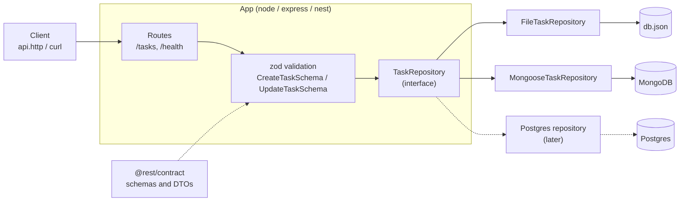
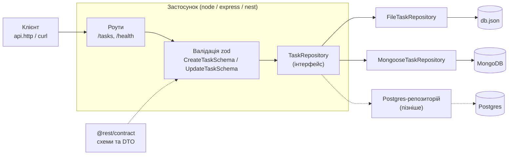

# REST: Node vs Express vs Nest

<details open>
<summary><b>English</b></summary>

<br/>

A study monorepo: the same Task CRUD REST API is built 9 times — with plain Node, Express and NestJS, each with three storages (local JSON file, MongoDB, Postgres). The goal is to understand what Express and Nest do under the hood and what they hide from us.

Every implementation exposes the same API:

| Method   | Path         | Description             |
| -------- | ------------ | ----------------------- |
| `GET`    | `/tasks`     | list tasks              |
| `GET`    | `/tasks/:id` | get one task            |
| `POST`   | `/tasks`     | create a task           |
| `PATCH`  | `/tasks/:id` | partially update a task |
| `DELETE` | `/tasks/:id` | delete a task           |
| `GET`    | `/health`    | service (and DB) status |

### Implementation matrix

|             | local (JSON file) | mongo (MongoDB)  | postgres         |
| ----------- | ----------------- | ---------------- | ---------------- |
| **node**    | scaffold `:3101`  | scaffold `:3102` | scaffold `:3103` |
| **express** | done `:3201`      | done `:3202`     | scaffold `:3203` |
| **nest**    | scaffold `:3301`  | scaffold `:3302` | scaffold `:3303` |

**done** — implemented · **scaffold** — `package.json`, `tsconfig.json`, `.env.example` are set up, `src/` is still empty

### Architecture



### Stack

- **Node 22** (`.nvmrc`), **TypeScript**, ESM
- **pnpm workspaces** + **catalogs** (shared dependency versions in `pnpm-workspace.yaml`)
- **Turborepo** (`turbo.json`) — runs `dev` / `build` / `typecheck` across packages
- **zod** — input validation
- `packages/contract` (`@rest/contract`) — shared schemas and types: `CreateTaskSchema`, `UpdateTaskSchema`, `TaskDto`, `CreateTaskDto`, `UpdateTaskDto`. Consumed straight from source (`exports: ./src/index.ts`), no build step.
- **Docker Compose** — MongoDB 8 and Postgres 18 for local development

### Structure

```
.
├── docker/postgres/init.sql    # creates rest_node, rest_express, rest_nest databases
├── docker-compose.yml          # mongo + postgres
├── packages/
│   └── contract/               # @rest/contract: zod schemas and DTOs
├── node/                       # plain Node, no framework
│   ├── local/
│   ├── mongo/
│   └── postgres/
├── express/
│   ├── local/
│   ├── mongo/
│   └── postgres/
├── nest/
│   ├── local/
│   ├── mongo/
│   └── postgres/
├── package.json
├── pnpm-workspace.yaml
├── tsconfig.base.json
└── turbo.json
```

Example app — `express/mongo`:

```
express/mongo/
├── .env.example
├── api.http
├── package.json
├── tsconfig.json
└── src/
    ├── app.ts
    ├── index.ts
    ├── config/
    │   └── app.config.ts
    ├── db/
    │   └── mongoose.ts
    ├── mappers/
    │   └── task.mapper.ts
    ├── middlewares/
    │   └── error-handler.middleware.ts
    ├── models/
    │   └── task.model.ts
    ├── repositories/
    │   ├── mongoose-task.repository.ts
    │   └── task.repository.ts
    └── routes/
        ├── health.router.ts
        └── task.router.ts
```

### Quick start

```bash
nvm use                 # Node 22 from .nvmrc
pnpm install

# in every app you want to run
cp express/mongo/.env.example express/mongo/.env

# mongo/postgres apps only
pnpm db:up              # start MongoDB and Postgres (pnpm db:down to stop)

# run one app
pnpm --filter rest-node-express-mongo dev

# or a group / everything (via turbo)
pnpm dev:express        # also dev:node, dev:nest, dev (scaffolds without src/ will fail)
```

> On macOS you can run Docker via [colima](https://github.com/abiosoft/colima):
> `colima start --dns 1.1.1.1 --dns 8.8.8.8`

Package names for `--filter`: `rest-node-<framework>-<storage>` for express and nest (e.g. `rest-node-express-local`, `rest-node-nest-mongo`) and `rest-node-<storage>` for plain Node (`rest-node-local`, `rest-node-mongo`, `rest-node-postgres`).

Ports and environment variables are in each app's `.env.example` (`PORT`, plus `DB` for local, `MONGO_URL` for mongo, `DATABASE_URL` for postgres).

Finished apps include an `api.http` file for manual API testing (REST Client in VS Code / HTTP Client in JetBrains).

Type checking and build (scaffolds without `src/` fail for now):

```bash
pnpm typecheck
pnpm build
```

### Conventions

- Files are named `<entity>.<role>.ts`: `task.router.ts`, `task.repository.ts`, `mongoose-task.repository.ts`, `error-handler.middleware.ts`.
- Role folders are plural (`routes/`, `repositories/`, `models/`, `middlewares/`, `mappers/`); exceptions are `config/` and `db/`.
- Task types and schemas are not duplicated in apps — they are imported from `@rest/contract` only.
- Every app has a `TaskRepository` interface; routes depend on it, not on a concrete storage.

</details>

<details>
<summary><b>Українська</b></summary>

<br/>

Навчальний монорепозиторій: той самий REST API для задач (Task CRUD) реалізується 9 разів — на чистому Node, на Express і на NestJS, кожен із трьома сховищами (локальний JSON-файл, MongoDB, Postgres). Мета — зрозуміти, що Express і Nest роблять «під капотом» і що вони від нас приховують.

API в усіх реалізацій однаковий:

| Метод    | Шлях         | Опис                  |
| -------- | ------------ | --------------------- |
| `GET`    | `/tasks`     | список задач          |
| `GET`    | `/tasks/:id` | одна задача           |
| `POST`   | `/tasks`     | створити задачу       |
| `PATCH`  | `/tasks/:id` | частково оновити      |
| `DELETE` | `/tasks/:id` | видалити              |
| `GET`    | `/health`    | статус сервісу (і БД) |

### Матриця реалізацій

|             | local (JSON-файл) | mongo (MongoDB)   | postgres          |
| ----------- | ----------------- | ----------------- | ----------------- |
| **node**    | заготовка `:3101` | заготовка `:3102` | заготовка `:3103` |
| **express** | готово `:3201`    | готово `:3202`    | заготовка `:3203` |
| **nest**    | заготовка `:3301` | заготовка `:3302` | заготовка `:3303` |

**готово** — реалізовано · **заготовка** — налаштовані `package.json`, `tsconfig.json`, `.env.example`, але `src/` поки порожній

### Архітектура



### Стек

- **Node 22** (`.nvmrc`), **TypeScript**, ESM
- **pnpm workspaces** + **catalogs** (єдині версії залежностей у `pnpm-workspace.yaml`)
- **Turborepo** (`turbo.json`) — запуск `dev` / `build` / `typecheck` по всіх пакетах
- **zod** — валідація вхідних даних
- `packages/contract` (`@rest/contract`) — спільні схеми й типи: `CreateTaskSchema`, `UpdateTaskSchema`, `TaskDto`, `CreateTaskDto`, `UpdateTaskDto`. Підключається напряму з вихідного коду (`exports: ./src/index.ts`), без збірки.
- **Docker Compose** — MongoDB 8 і Postgres 18 для локальної розробки

### Структура

```
.
├── docker/postgres/init.sql    # створює БД rest_node, rest_express, rest_nest
├── docker-compose.yml          # mongo + postgres
├── packages/
│   └── contract/               # @rest/contract: zod-схеми та DTO
├── node/                       # чистий Node, без фреймворків
│   ├── local/
│   ├── mongo/
│   └── postgres/
├── express/
│   ├── local/
│   ├── mongo/
│   └── postgres/
├── nest/
│   ├── local/
│   ├── mongo/
│   └── postgres/
├── package.json
├── pnpm-workspace.yaml
├── tsconfig.base.json
└── turbo.json
```

Приклад застосунку — `express/mongo`:

```
express/mongo/
├── .env.example
├── api.http
├── package.json
├── tsconfig.json
└── src/
    ├── app.ts
    ├── index.ts
    ├── config/
    │   └── app.config.ts
    ├── db/
    │   └── mongoose.ts
    ├── mappers/
    │   └── task.mapper.ts
    ├── middlewares/
    │   └── error-handler.middleware.ts
    ├── models/
    │   └── task.model.ts
    ├── repositories/
    │   ├── mongoose-task.repository.ts
    │   └── task.repository.ts
    └── routes/
        ├── health.router.ts
        └── task.router.ts
```

### Швидкий старт

```bash
nvm use                 # Node 22 з .nvmrc
pnpm install

# у кожному потрібному застосунку
cp express/mongo/.env.example express/mongo/.env

# лише для mongo/postgres-застосунків
pnpm db:up              # підняти MongoDB і Postgres (pnpm db:down — зупинити)

# запустити один застосунок
pnpm --filter rest-node-express-mongo dev

# або групу / все одразу (через turbo)
pnpm dev:express        # також dev:node, dev:nest, dev (заготовки без src/ впадуть)
```

> На macOS Docker можна запускати через [colima](https://github.com/abiosoft/colima):
> `colima start --dns 1.1.1.1 --dns 8.8.8.8`

Імена пакетів для `--filter`: `rest-node-<framework>-<storage>` для express і nest (наприклад, `rest-node-express-local`, `rest-node-nest-mongo`) і `rest-node-<storage>` для чистого Node (`rest-node-local`, `rest-node-mongo`, `rest-node-postgres`).

Порти та змінні оточення — у `.env.example` кожного застосунку (`PORT`, плюс `DB` для local, `MONGO_URL` для mongo, `DATABASE_URL` для postgres).

Для ручної перевірки API в готових застосунках є `api.http` (REST Client у VS Code / HTTP Client у JetBrains).

Перевірка типів і збірка (заготовки без `src/` поки що падають):

```bash
pnpm typecheck
pnpm build
```

### Домовленості

- Файли називаються `<entity>.<role>.ts`: `task.router.ts`, `task.repository.ts`, `mongoose-task.repository.ts`, `error-handler.middleware.ts`.
- Папки ролей — у множині (`routes/`, `repositories/`, `models/`, `middlewares/`, `mappers/`); винятки — `config/` і `db/`.
- Типи та схеми Task не дублюються в застосунках — лише імпорт із `@rest/contract`.
- У кожному застосунку є інтерфейс `TaskRepository`; роути залежать від нього, а не від конкретного сховища.

</details>
