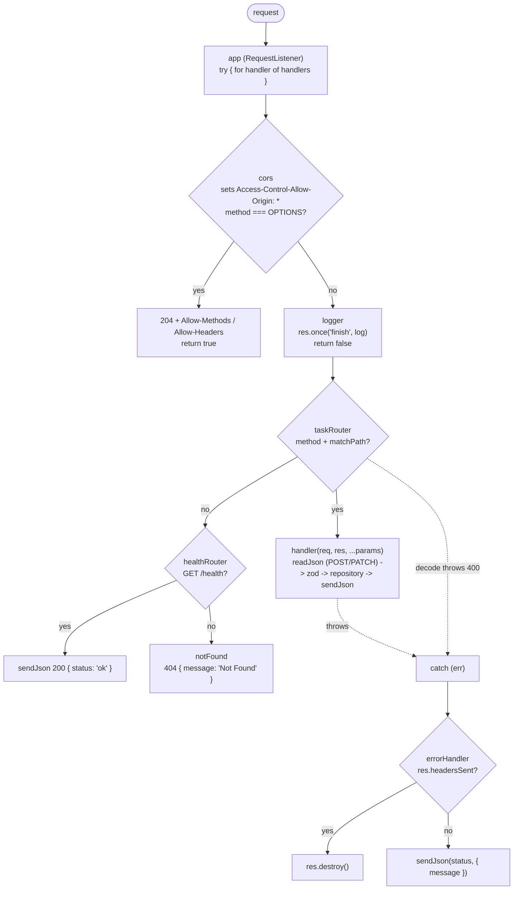

# rest-node-vanilla-local

The Task CRUD API (`{ id, title, isCompleted }`) built on plain `node:http`, with no framework: no Express, `cors`, `morgan` or `body-parser`. It is one of nine implementations in this study repo (node, express and nest, each backed by a local JSON file, mongo or postgres). It is a port of `express/local`, with the same routes, the same zod contract and the same repository. The goal is to show, in a small amount of code, what Express does for you: routing, body parsing, JSON responses, error handling, CORS and logging.

Runtime dependencies are only `@rest/contract` (shared zod schemas and DTOs) and `zod`.

## Quick start

```sh
cp node/local/.env.example node/local/.env      # --env-file fails if .env is missing

pnpm --filter rest-node-vanilla-local dev        # tsx watch --env-file=.env src/index.ts
pnpm --filter rest-node-vanilla-local typecheck  # tsc --noEmit
pnpm --filter rest-node-vanilla-local build      # tsc -> dist/
pnpm --filter rest-node-vanilla-local start      # node --env-file=.env dist/index.js

pnpm dev:node                                     # all node/* packages via turbo
```

Requirements: Node 22+ (developed on 22.19) and pnpm workspaces. The package is ESM (`"type": "module"`), and source imports use `.ts` extensions (`allowImportingTsExtensions` and `rewriteRelativeImportExtensions` in `tsconfig.base.json`).

| Variable | Default   | Meaning                                                                           |
| -------- | --------- | --------------------------------------------------------------------------------- |
| `PORT`   | `3101`    | Listen port, parsed with `parseInt` and not otherwise validated.                  |
| `DB`     | `db.json` | Path to the storage file, resolved with `path.resolve` against the process cwd.   |

`db.json` holds a plain JSON array of tasks. A missing file is treated as an empty list. A file that is not an array produces a 500.

```json
[
  { "id": "7a546299-a120-4d1a-8cac-956844d5ef90", "isCompleted": false, "title": "Second task" }
]
```

## API

All bodies are JSON. Errors always have the shape `{ "message": string }`.

| Method    | Path         | Success                | Errors                                                           |
| --------- | ------------ | ---------------------- | ---------------------------------------------------------------- |
| `GET`     | `/health`    | 200 `{ status: "ok" }` | none                                                             |
| `GET`     | `/tasks`     | 200 `{ tasks }`        | 500                                                              |
| `GET`     | `/tasks/:id` | 200 `{ task }`         | 400 (bad percent-encoding), 404                                  |
| `POST`    | `/tasks`     | 201 `{ task }`         | 400 (invalid JSON or validation), 413, 415                       |
| `PATCH`   | `/tasks/:id` | 200 `{ task }`         | 400, 404, 413, 415                                               |
| `DELETE`  | `/tasks/:id` | 204, no body           | 400 (bad percent-encoding), 404                                  |
| `OPTIONS` | any path     | 204 (CORS preflight)   | none                                                             |
| any other | any path     | none                   | 404 `{ message: "Not Found" }` (there is no 405)                 |

Any unexpected exception becomes 500 `{ "message": "Something went wrong!" }`, and the stack trace is printed to stderr.

## Project structure

```text
node/local/
├── .env.example                      PORT=3101, DB=db.json
├── api.http                          REST Client / JetBrains HTTP requests
├── db.json                           storage file (JSON array)
├── package.json                      rest-node-vanilla-local; dev/build/start/typecheck
├── tsconfig.json                     extends ../../tsconfig.base.json, src -> dist
└── src/
    ├── index.ts                      createServer, listen, startup error, graceful shutdown
    ├── app.ts                        the RequestListener: handler chain + top-level try/catch
    ├── configs/app.config.ts         PORT and DB from process.env
    ├── errors/http.error.ts          HttpError(status, message)
    ├── helpers/
    │   ├── router.helper.ts          Handler/Route types, matchPath, createRouter
    │   ├── json-body.helper.ts       readJson: replaces express.json()
    │   └── send.helper.ts            sendJson: replaces res.status().json()
    ├── middlewares/
    │   ├── cors.middleware.ts        replaces cors()
    │   ├── logger.middleware.ts      replaces morgan('tiny')
    │   └── error-handler.middleware.ts  replaces the Express error middleware
    ├── repositories/
    │   ├── task.repository.ts        TaskRepository interface
    │   └── file-task.repository.ts   JSON file storage (same as express/local)
    └── routes/
        ├── task.router.ts            /tasks CRUD + zod validation
        └── health.router.ts          GET /health
```

## Request lifecycle



## How it works

### Server and `RequestListener`

`index.ts` passes `app` to `createServer`. `app` is a `RequestListener`, the `(req, res) => void` callback that Node calls for every `'request'` event. `req` is an `IncomingMessage` (a readable stream plus the method, URL and headers), and `res` is a `ServerResponse` (a writable stream). Nothing is set up for you: no `req.params`, no `req.body`, no `res.json`.

```ts
const server = createServer(app);

server.on('error', (err) => {
  console.error(`Failed to start server: ${err.message}`);
  process.exit(1);
});

server.listen(config.port, () => console.log(`Server is running on port: ${config.port}`));
```

Startup errors such as `EADDRINUSE` arrive as an `'error'` event on the server, not as an exception from `listen`.

### Handler chain

Express middleware has the signature `(req, res, next)`, and you call `next()` to continue. Here every step is a `Handler` that returns `true` when it has handled the request and `false` to pass it on:

```ts
export type Handler = (req: IncomingMessage, res: ServerResponse) => boolean | Promise<boolean>;

const handlers = [cors, logger, createTaskRouter(taskRepository), createHealthRouter(), notFound];

export const app: RequestListener = async (req, res) => {
  try {
    for (const handler of handlers) {
      if (await handler(req, res)) return;
    }
  } catch (err) {
    errorHandler(err, req, res);
  }
};
```

Order matters as it does in `app.use`. `cors` runs first so that preflights end before the logger. `notFound` always returns `true`, so it is the final catch-all. There is no `next(err)`: an error is simply thrown and caught by the single `try/catch`.

### Router

`createRouter(routes)` turns an array of `{ method, path, handler }` into one `Handler`. Each router file (`task.router.ts`, `health.router.ts`) produces one `Handler`. Paths are full paths such as `'/tasks/:id'`, because nothing is mounted under a prefix.

```ts
const matchPath = (pattern: string, pathname: string) => {
  const desiredStr = pattern.split('/').filter(Boolean);
  const gotStr = pathname.split('/').filter(Boolean);
  if (desiredStr.length !== gotStr.length) return undefined;
  // ':x' segments are collected into params; literal segments must match exactly
  ...
};
```

- **Path source:** `new URL(req.url ?? '/', 'http://localhost').pathname`. The query string is ignored, so `GET /tasks?x=1` lists all tasks.
- **Params are positional:** `matchPath('/tasks/:id', '/tasks/abc')` returns `['abc']`, and the handler receives them as extra arguments, as in `handler(req, res, id)`. The name after `:` is for documentation only.
- **Decoding:** params are decoded with `decodeURIComponent` after matching. A malformed sequence (`/tasks/%`, `/tasks/%E0%A4%A`) throws `HttpError(400, "Failed to decode param '...'")`. `/tasks/a%20b` reaches the handler as `a b`.
- **Empty segments are dropped:** `filter(Boolean)` makes `/tasks/` match `/tasks` and `/tasks//<id>` match `/tasks/:id`.
- **Case-sensitive:** `/TASKS` returns 404.
- **Method matching is exact:** `route.method !== req.method`. `HEAD` is not mapped to `GET`.
- **No 405:** a known path with an unknown method (`PUT /tasks/:id`) falls through every router to `notFound`, which returns 404.
- Once a route matches, the router awaits the handler and returns `true`. The handler is responsible for sending a response.

### Body parsing

`readJson(req)` replaces `express.json()`. It is called only inside the handlers that need a body (`POST /tasks` and `PATCH /tasks/:id`), not before routing.

1. **Fast 413:** if `Content-Length` exceeds `LIMIT` (`100 * 1024`, the Express `'100kb'` default), it throws `HttpError(413)` without reading the stream.
2. **Read the stream:** `for await (const chunk of req)` collects `Buffer` chunks. After the limit is exceeded it keeps reading but stops storing. Breaking out of the loop would call `req.destroy()` and reset the socket, so the client would never see the 413. This path covers chunked bodies with no `Content-Length`.
3. After the loop: `size > LIMIT` throws 413, and an empty body returns `undefined`.
4. **Content-Type:** the media type (before `;`, lower-cased) must be exactly `application/json`, otherwise it throws 415. The check happens only for a non-empty body. The charset parameter is ignored.
5. **Decode once:** `Buffer.concat(chunks).toString('utf-8')`. Decoding per chunk would corrupt multi-byte characters split across chunks.
6. **Parse:** if `JSON.parse` fails, it throws `HttpError(400, err.message)`. Any JSON value is accepted here; non-objects are rejected later by zod.

### Validation

Validation is the same as in express/local. Schemas come from `@rest/contract`, and only the input changes from `req.body` to `await readJson(req)`:

```ts
const { data, success, error } = CreateTaskSchema.safeParse(await readJson(req));

if (!success) {
  const message = error.issues.map((issue) => issue.message).join('; ');
  return sendJson(res, 400, { message });
}
```

`CreateTaskSchema` requires a non-empty trimmed `title`, and `isCompleted` defaults to `false`. `UpdateTaskSchema` is partial but requires at least one field. A body of `undefined` or a non-object fails with `body must be a JSON object`.

### Responses

`sendJson(res, status, body?)` replaces `res.status().json()` and `res.sendStatus()`:

```ts
if (res.headersSent || res.writableEnded) return;
res.statusCode = status;
if (status === 204 || status === 304 || body === undefined) return res.end();
const json = JSON.stringify(body);
res.setHeader('Content-Type', 'application/json; charset=utf-8');
res.setHeader('Content-Length', Buffer.byteLength(json));
res.end(json);
```

- `Buffer.byteLength`, not `json.length`: `Content-Length` counts bytes, and `'задача'.length` is 6 while its UTF-8 encoding is 12 bytes.
- `Content-Length` is set explicitly so that the logger can read it with `res.getHeader`. Node's automatic header is not visible there.
- 204 and 304 never carry a body or `Content-Type`.
- A second send is a silent no-op instead of an `ERR_HTTP_HEADERS_SENT` exception.

### Errors

`HttpError` (`src/errors/http.error.ts`) is an `Error` with a `status`. Anything expected (400, 413, 415) is thrown as an `HttpError`. Everything else counts as a 500.

```ts
export const errorHandler = (err: unknown, _req: IncomingMessage, res: ServerResponse) => {
  const status = err instanceof HttpError ? err.status : 500;
  if (status >= 500) console.error(err);
  if (res.headersSent) return res.destroy();
  sendJson(res, status, { message: err instanceof HttpError && status < 500 ? err.message : 'Something went wrong!' });
};
```

- 5xx details are logged but hidden from the client.
- If headers are already sent, a JSON error cannot be written, so the connection is destroyed. Express's `finalhandler` does the same.
- **Why the top-level `try/catch` is required:** Node's `'request'` event ignores the promise that an `async` listener returns. A rejection would be unhandled, and since Node 15 the default `--unhandled-rejections=throw` crashes the whole process. Express 5 catches rejected handler promises for you. Here, `app` must do it.

### CORS

`cors` replaces `cors()` with default options:

- Every response gets `Access-Control-Allow-Origin: *`.
- `OPTIONS` on any path, including unknown ones, is answered as a preflight: `204`, `Access-Control-Allow-Methods: GET,HEAD,PUT,PATCH,POST,DELETE`, `Access-Control-Allow-Headers` echoed from `Access-Control-Request-Headers`, `Vary: Access-Control-Request-Headers`, and `Content-Length: 0` (Safari otherwise waits for a body). The handler then returns `true`, so the request goes no further.

### Logger

`logger` reproduces `morgan('tiny')`: `:method :url :status :res[content-length] - :response-time ms`.

```ts
const start = performance.now();
res.once('finish', () => {
  const ms = (performance.now() - start).toFixed(3);
  const length = res.getHeader('content-length') ?? '-';
  console.log(`${req.method} ${req.url} ${res.statusCode} ${length} - ${ms} ms`);
});
return false;
```

It never responds itself. It subscribes to `'finish'`, which fires once the response has been handed to the socket, when the status and length are final. A 204 logs `-` for the length. Because `cors` runs first, preflights are not logged, the same as in express/local.

### Repository

`FileTaskRepository` implements `TaskRepository` (`findAll`, `findById`, `create`, `update`, `delete`) and is logically identical to express/local. It knows nothing about HTTP, so it moved over unchanged apart from cosmetic edits.

- **Write queue:** every mutation runs inside `#mutate`, which chains onto `#queue`. Each read-modify-write therefore runs one at a time, and concurrent POSTs cannot overwrite each other. `this.#queue = run.catch(() => {})` keeps the chain alive after a failed mutation, while the caller still receives the rejection.
- **Atomic writes:** the data is written to `${file}.tmp` and then `rename`d over the real file. A reader sees either the old or the new file, never a half-written one.
- **Reads are not queued.** They read the last file that was fully renamed into place.
- IDs come from `randomUUID()` in `node:crypto` (UUID v4).

### Graceful shutdown

```ts
const shutdown = (signal: NodeJS.Signals) => {
  console.log(`${signal} received, closing server`);
  server.close((err) => { if (err) { console.error(err); process.exitCode = 1; } });
  server.closeIdleConnections();
  setTimeout(() => server.closeAllConnections(), 10_000).unref();
};

process.once('SIGINT', shutdown);
process.once('SIGTERM', shutdown);
```

- `server.close` stops accepting new connections. Its callback runs once all existing connections have ended, and the process then exits on its own because the event loop is empty.
- `closeIdleConnections` drops idle keep-alive sockets immediately. Since Node 19 `close()` also does this, so the call is redundant but makes the intent explicit. Without it, an idle browser connection could hold the process open for the keep-alive timeout.
- After 10 s, `closeAllConnections` cuts off requests that are still in flight. `.unref()` means this timer alone does not keep the process alive.
- `process.once` handles only the first signal, so a second Ctrl+C falls back to Node's default handler and kills the process immediately.

## Express → Node mapping

| Express (express/local)                      | Here                                                                 |
| -------------------------------------------- | -------------------------------------------------------------------- |
| `express()`, `app.listen`                    | `createServer(app)`, `server.listen` + `'error'` event (`index.ts`)  |
| `app.use(mw)`, `next()`                      | `handlers` array, `Handler` returning `true`/`false` (`app.ts`)      |
| `Router()`, `router.get('/:id')`             | `createRouter([{ method, path, handler }])` (`router.helper.ts`)     |
| `app.use('/tasks', router)`                  | full paths in routes (`'/tasks/:id'`), no mounting                    |
| `req.params.id`                              | positional handler argument `id`                                      |
| `express.json()`, `req.body`                 | `await readJson(req)` (`json-body.helper.ts`)                         |
| `res.status(n).json(body)`, `res.sendStatus` | `sendJson(res, n, body?)` (`send.helper.ts`)                          |
| `http-errors` / `err.status`                 | `HttpError` (`errors/http.error.ts`)                                  |
| error middleware `(err, req, res, next)`     | `errorHandler` + `try/catch` in `app` (`error-handler.middleware.ts`) |
| Express 5 async error catching               | `try/catch` around the `await handler(...)` loop                      |
| `cors()`                                     | `cors` handler (`cors.middleware.ts`)                                 |
| `morgan('tiny')`                             | `logger` handler (`logger.middleware.ts`)                             |
| final 404 middleware                         | `notFound` handler (`app.ts`)                                         |
| none (express/local has no shutdown)         | `shutdown` on SIGINT/SIGTERM (`index.ts`)                             |

## What Express does that this package does not

- **ETag / 304:** `res.json` adds a weak ETag and answers `If-None-Match` with 304. Here there is no ETag and every response is a full 200.
- **HEAD:** Express routes `HEAD` to the `GET` handler and strips the body. Here `HEAD` returns 404.
- **`X-Powered-By: Express`:** not sent.
- **Query parser:** `req.query` does not exist, and the query string is ignored.
- **req/res prototype extensions:** no `req.params`, `req.body`, `req.ip`, `req.hostname`, `req.get`, `res.status`, `res.json`, `res.send`, `res.set` or `res.redirect`.
- **`trust proxy`:** `X-Forwarded-*` headers are ignored.
- **Mounting and sub-apps:** no `app.use('/prefix', router)`, `req.baseUrl` or nested routers.
- **path-to-regexp features:** no optional params, wildcards, regex constraints or named-param objects. Matching is case-sensitive, with no `strict` or `caseSensitive` options.
- **body-parser details:** no strict mode (a top-level string or number parses fine and is rejected by zod), no charset check, no gzip/deflate/br decompression, no `+json` media types, no `reviver`, and no `urlencoded`, `text` or `raw` parsers. The body is read only by handlers that need it.
- **morgan options:** only the `tiny` format, always to stdout, with no `skip` or custom tokens.
- **cors options:** origin is always `*`. There is no origin allow-list, no credentials, no `maxAge` and no `exposedHeaders`.

## Behavioral differences from express/local

Checked with curl against both servers running side by side.

| Request                                                    | express/local                                    | node/local                                   |
| ---------------------------------------------------------- | ------------------------------------------------ | -------------------------------------------- |
| `POST /tasks`, `Content-Type: text/plain`, JSON body       | 400 `body must be a JSON object` (body skipped)  | 415 `Content-Type must be application/json`  |
| `POST /tasks`, `application/vnd.api+json`                  | 400 (body skipped)                               | 415                                          |
| `POST /tasks`, `application/json; charset=latin1`          | 415 `unsupported charset "LATIN1"`               | 201 (charset ignored)                        |
| `POST /tasks`, body `"str"`                                | 400 JSON parse error (strict mode)               | 400 `body must be a JSON object`             |
| broken JSON to an unknown route (`POST /nope`)             | 400 (body parsed before routing)                 | 404                                          |
| `GET /TASKS`                                               | 200 (case-insensitive)                           | 404                                          |
| `GET /tasks//<id>`                                         | 404                                              | 200 (empty segments dropped)                 |
| `HEAD /tasks`                                              | 200                                              | 404                                          |
| `PUT /tasks/<id>`                                          | 404                                              | 404 (no 405 in either)                       |
| 404 message                                                | `Not found`                                      | `Not Found`                                  |
| `X-Powered-By`, `ETag`, 304 on `If-None-Match`             | yes                                              | no                                           |
| default `PORT`                                             | 3201                                             | 3101                                         |
| SIGINT                                                     | immediate default exit                           | graceful `server.close`                      |

These behave the same in both: 413 by `Content-Length` and for chunked bodies, 400 on `%`-decoding errors, the validation messages, the 500 message, `/tasks/` matching `/tasks`, and the 204 preflight on any path.

## Testing

`api.http` (VS Code REST Client or JetBrains HTTP Client) covers every route and error case. Adjust `@existingId`, `@updatedId` and `@deletedId` to IDs that exist in your `db.json`, and create `big.json` for the 413 case as the comment in the file describes.

```sh
B=http://localhost:3101
curl -i $B/health
curl -i -X POST $B/tasks -H 'Content-Type: application/json' -d '{"title":"Buy milk"}'   # 201
curl -i -X POST $B/tasks -H 'Content-Type: text/plain' -d '{"title":"x"}'             # 415
curl -i -X PATCH $B/tasks/<id> -H 'Content-Type: application/json' -d '{}'            # 400
curl -i $B/tasks/%E0%A4%A                                                              # 400
curl -i -X OPTIONS $B/tasks -H 'Access-Control-Request-Headers: content-type'         # 204

# 413 without Content-Length (chunked)
node -e "process.stdout.write(JSON.stringify({ title: 'x'.repeat(200_000) }))" > big.json
curl -i -X POST $B/tasks -H 'Content-Type: application/json' \
  -H 'Transfer-Encoding: chunked' --data-binary @big.json

# write queue: 10 parallel creates must all be 201 and all be saved
for i in $(seq 10); do curl -s -o /dev/null -w '%{http_code} ' -X POST $B/tasks \
  -H 'Content-Type: application/json' -d "{\"title\":\"p$i\"}" & done; wait
```
